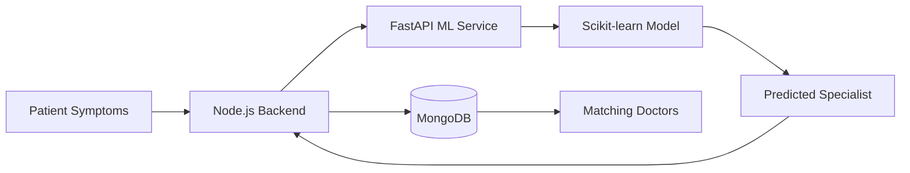
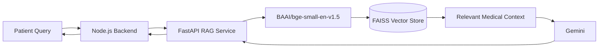
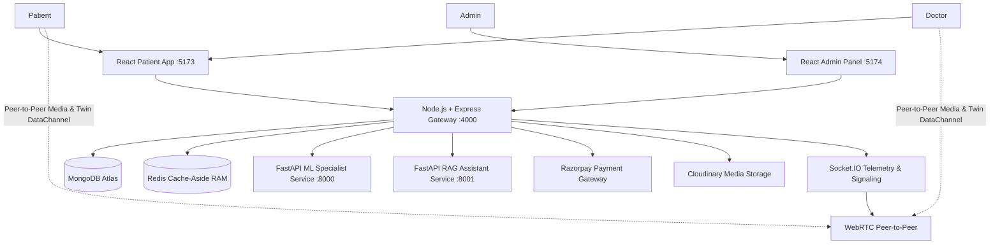

# 🧬 Prescripto: AI-Powered Doctor Appointment, Tele-Consultation & Patient Digital Twin Platform

Prescripto is an end-to-end clinical healthcare and telemedicine platform combining AI-assisted specialist recommendation, doctor discovery and appointment booking, Razorpay online payments, real-time doctor-patient communication, WebRTC video consultation, and continuous physiological Digital Twin counterfactual modeling.

> **Submitted for the Happiest Health — Digital Twin Challenge 2026**  
> *Transforming Reactive Healthcare into Continuous, Predictive, Counterfactual Health Simulation.*  
>  
> **Prescripto = AI Triage + Doctor Discovery + Appointment Booking + Payment + Tele-Consultation + Continuous Digital Twin Simulation**

---

## 🌐 Live Deployment

* **User App:** [https://medlink360-frontend.onrender.com](https://medlink360-frontend.onrender.com)
* **Admin Panel:** [https://medlink360-admin.onrender.com](https://medlink360-admin.onrender.com)
* **Backend API:** [https://medlink-backend-2bgo.onrender.com](https://medlink-backend-2bgo.onrender.com)
* **AI ML Service:** [https://medlink360.onrender.com](https://medlink360.onrender.com)
* **RAG Medical Assistant:** Implemented & tested locally in [`rag-service/`](./rag-service) *(see deployment notes below)*

---

## 👥 Team Details

### 1. Aarush Bharti (Team Leader / Primary Developer)
* **Email:** [aarushbharti2005@gmail.com](mailto:aarushbharti2005@gmail.com)
* **GitHub:** [@Aarush-bigO](https://github.com/Aarush-bigO)
* **Role:** Lead AI Architect & Full-Stack Systems Engineer — Multi-tier Architecture, Digital Twin Mathematical Core & Tele-Consultation Integration
* **College:** Indian Institute of Information Technology (IIIT)

### 2. Ananya Pandey (Co-Developer & Team Member)
* **Role:** Clinical AI & Health Informatics Lead — RAG Knowledge Retrieval Pipeline, ML Specialist Triage Engine & Interactive Digital Twin Simulation
* **College:** Newton School of Technology, Pune

## 🏛️ College / Incubator Information

* **Institutions:**
  * Indian Institute of Information Technology (IIIT)
  * Newton School of Technology, Pune
* **Department:** Computer Science & Engineering / AI & Data Science
* **Program:** Bachelor of Technology (B.Tech)

---

## 🎯 Problem Statement

Traditional telemedicine and clinical care platforms suffer from two fundamental bottlenecks:

1. **Specialist Misdirection:** Patients reporting symptoms often do not know which medical specialist they should consult, resulting in delayed care, improper consultations, and wasted clinical bandwidth.
2. **Episodic & Reactive Care:** 
   * **Disconnected Data:** Patient vitals (Blood Pressure, Glucose, Cholesterol, BMI, Resting Heart Rate) are recorded intermittently with zero continuous physiological modeling.
   * **Lack of Predictive Forecasting:** Patients cannot visualize the prospective trajectory of their health or understand how chronic conditions (cardiovascular risk, Type-2 Diabetes) develop over 1 to 5 years.
   * **No Counterfactual "What-If" Sandbox:** Doctors and patients have no clinical simulation environment to evaluate lifestyle interventions (*"What if sodium is reduced by 25%?"*, *"What if daily walking increases to 45 mins?"*, *"What if medication adherence reaches 90%?"*) prior to prescribing treatments.

---

## 🏥 Healthcare Use Case & Digital Twin Formulation

### Longitudinal Chronic Disease Prevention & Personalized Clinical Simulation
Prescripto Digital Twin introduces a **continuous, computational virtual representation of the patient's physiology**:
* **Continuous Biomarker Telemetry:** Ingestion and normalization of cardiovascular, metabolic, and lifestyle parameters (Blood Pressure, HbA1c, Fasting Blood Sugar, Lipid Profiles, BMI, Daily Activity, Sleep).
* **Dynamic Organ Twin Health Scores:** Real-time scoring of Cardiovascular Twin, Metabolic Twin, and Biological Cellular Aging.
* **Counterfactual "What-If" Intervention Engine:** Interactive simulation modeling the prospective trajectory of chronic disease risk over 1, 3, and 5-year horizons using differential transfer equations.
* **Tele-Twin Collaborative Clinical Review:** During WebRTC audio/video consultations, doctors review the patient's synchronized Digital Twin and simulation curves live on-screen to calibrate personalized medical prescriptions.

```text
Patient Symptoms & Biomarkers
               │
               ▼
     [ Node.js Backend API ]
               │
               ▼
  [ 🤖 AI Triage & Twin Core ]
  ├── Scikit-Learn Multiclass Specialist Classifier
  ├── Framingham ASCVD 10-Yr Cardiovascular Risk Core
  ├── UKPDS Glycemic Drift & Metabolic Progression
  └── Biological Cellular Age Calculation
               │
               ▼
 [ 👨‍⚕️ Recommended Specialists & Matching Doctors ]
               │
               ▼
 [ 📅 Slot Reservation & Razorpay Payment Escrow ]
               │
               ▼
 [ 🔮 Counterfactual "What-If" Simulation Sandbox ]
  ├── Daily Physical Activity (+15 to +60 min)
  ├── Dietary Sodium & Carbohydrate Reduction (%)
  └── Pharmacological Regimen Adherence (%)
               │
               ▼
 [ 🩺 Live Tele-Twin Doctor Consultation ]
  └── WebRTC Video Call + Live Twin Telemetry Stream
```

---

## ✨ Key Features Categorized by Persona

### 👤 Patient Experience
* **JWT Authentication:** Secure user registration, login, and encrypted cookie/token sessions.
* **Profile & Medical Records:** Comprehensive management of personal vitals, chronic history, and emergency contacts.
* **AI Specialist Triage:** Multi-symptom natural language input with instant specialist matching.
* **Doctor Discovery:** Search and browse verified doctors filtered by specialty, experience, and consultation fee.
* **Appointment Booking & Cancellation:** Flexible slot reservation with instant status updates and history tracking.
* **Razorpay Payment Escrow:** Secure digital payments with server-side HMAC-SHA256 signature verification.
* **Real-Time Messaging:** Socket.IO chat for instant messaging before and after consultations.
* **WebRTC Peer-to-Peer Video Call:** High-definition, encrypted tele-consultation directly in the browser.
* **Interactive Digital Twin HUD:** Live visualization of Cardiovascular Score, Metabolic Score, and Biological Age delta.
* **Counterfactual What-If Sandbox:** Real-time sliders to forecast health improvement over 1, 3, and 5 years.

### 🩺 Doctor Experience
* **Secure Doctor Portal:** Role-based access for verified medical practitioners.
* **Profile & Credentials:** Customizable medical bio, qualifications, consultation fees, and profile image.
* **Availability Management:** Dynamic toggle of working hours, slot creation, and real-time availability sync.
* **Appointment Management:** Review upcoming consultations, mark appointments completed, or cancel unpaid slots.
* **Financial Analytics:** Clear breakdown of consultation revenue, patient volume, and earnings dashboard.
* **Tele-Twin Consultation Suite:** WebRTC video interface synchronized with the patient's live Digital Twin HUD.

### 🛡️ Admin Experience
* **Master Admin Dashboard:** Centralized platform governance and operational analytics.
* **Doctor Lifecycle Management:** Onboard, verify, update, and manage doctor credentials and profiles.
* **Availability Oversight:** Platform-wide oversight and manual override of doctor active status.
* **Appointment Auditing:** View, filter, and audit all platform bookings, transactions, and cancellations.
* **System Telemetry:** Real-time metrics on user acquisition, booking conversion, and service health.

---

## 🤖 AI Medical Triage Service

Prescripto incorporates an AI triage classifier that bridges natural language symptom complaints directly to clinical specialties before doctor selection:



* **Microservice Topology:** Python 3.11, FastAPI, Uvicorn, Scikit-learn, and Joblib.
* **Model Formulation:** Multiclass Multinomial Naive Bayes / ensemble classifier trained on multi-symptom clinical datasets.
* **Inference Pipeline:** Input symptom normalization $\rightarrow$ TF-IDF vectorization $\rightarrow$ specialty probability vector $\rightarrow$ fallback heuristic routing if maximum probability is below confidence threshold ($< 75\%$).

---

## 🧠 RAG Medical Assistant Service

Prescripto features a dedicated Retrieval-Augmented Generation (RAG) microservice for grounded medical question-answering and chronic disease educational retrieval without hallucinations:



### Complete RAG Ingestion & Query Pipeline
```text
Medical Documents (Markdown Corpus)
               │
               ▼
       Document Ingestion
               │
               ▼
  Recursive Character Text Chunking
               │
               ▼
   BAAI/bge-small-en-v1.5 Embeddings
               │
               ▼
    FAISS FlatL2 Vector Index
               │
               ▼
  Sub-Millisecond Semantic Retrieval
               │
               ▼
  Clinically Grounded Context Delivery
               │
               ▼
   Gemini 3.8 Flash Generation Core
               │
               ▼
    Verified Educational Medical Response
```

### RAG Service Codebase Structure
```text
rag-service/
├── app/
│   ├── build_index.py        # Offline vector indexing pipeline
│   ├── embeddings.py         # Sentence-Transformers BGE model loader
│   ├── generator.py          # Gemini prompt templates & safety filters
│   ├── ingest.py             # Markdown document parsing and chunking
│   ├── main.py               # FastAPI endpoints for search & generation
│   └── retriever.py          # FAISS FlatL2 similarity retrieval logic
├── data/
│   └── documents/
│       ├── asthma.md         # Clinical protocols: Asthma management
│       ├── common-cold.md    # Clinical protocols: Upper respiratory infections
│       ├── diabetes.md       # Clinical protocols: Type-1 & Type-2 diabetes
│       ├── fever.md          # Clinical protocols: Pediatric & adult pyrexia
│       ├── gerd.md           # Clinical protocols: Gastroesophageal reflux
│       ├── hypertension.md   # Clinical protocols: Essential hypertension & SBP
│       ├── migraine.md       # Clinical protocols: Neurological cephalalgia
│       └── pneumonia.md      # Clinical protocols: Pulmonary infections
├── vectorstore/
│   ├── index.faiss           # Pre-computed 384-dimensional dense vector index
│   └── metadata.json         # Document chunk source mapping & metadata
└── requirements.txt
```

> **Deployment Status:** The RAG service is fully implemented, verified, and operational locally. It is currently not deployed on the free-tier cloud instance due to RAM memory constraints of transformer embedding models in containerized micro-instances. The service runs locally with standard Python environments or Docker.
>
> ⚠️ **Clinical Safety Disclaimer:** The RAG assistant is designed solely for patient educational guidance. It does not provide definitive medical diagnoses, prescriptions, or clinical treatment directives and should never replace qualified physician consultations.

---

## 🧬 Digital Twin Computational Framework & Simulation Equations

The Digital Twin engine transforms raw biomarkers into a dynamic physiological model:

1. **Cardiovascular Risk Twin (Framingham ASCVD):**
   $$\text{Risk}_{\text{ASCVD}} = 1 - S_{10}(t)^{\exp(\sum \beta_i X_i - \overline{\beta X})}$$
   Evaluates systolic blood pressure, total cholesterol, HDL, smoking status, age, and antihypertensive medication use to compute 10-year major adverse cardiac event probability.

2. **Metabolic Health Twin (UKPDS Glycemic Progression):**
   Models fasting blood glucose, HbA1c, and BMI trajectories over 1, 3, and 5-year horizons to project metabolic syndrome and Type-2 Diabetes escalation.

3. **Biological Cellular Age Delta:**
   $$\text{Biological Age} = \text{Chronological Age} + \Delta_{\text{BP}} + \Delta_{\text{HbA1c}} + \Delta_{\text{BMI}} - \Delta_{\text{Activity}} - \Delta_{\text{Sleep}}$$

4. **Counterfactual "What-If" Differential Transfer Equations:**
   * **Systolic BP Delta:** $\Delta\text{SBP} = -0.08 \times \Delta\text{Activity (min)} - 0.12 \times \Delta\text{Sodium Reduction (\%)} - 0.35 \times \Delta\text{Weight (kg)}$
   * **Glycated Hemoglobin Delta:** $\Delta\text{HbA1c} = -0.015 \times \Delta\text{Med Adherence (\%)} - 0.010 \times \Delta\text{Nutrition (\%)} - 0.05 \times \Delta\text{Weight (kg)}$

---

## 🏗️ Master System Architecture (13 Widescreen Slides)



> **Publication-Grade Architectural Blueprint:** Full enterprise architecture specification designed in high-density 16:9 Canva/Figma presentation format, modeling all data pipelines, caching tiers, cryptographic payments, and physiological counterfactual mathematics.
> 
> 📥 **[Download Architecture Specification PDF (13 Slides, 2.5 MB)](./docs/architecture_diagram.pdf)** | 📋 **[Browse Full Documentation Catalog](./docs/README.md)**

<div align="center">
  <a href="./docs/architecture_diagram.pdf">
    
  </a>
  <p><em>Click above to download the full 13-slide publication-grade presentation PDF.</em></p>
</div>

### 📑 Architecture Slide Deck Index

| Slide | Blueprint Title | Subsystem Focus | Preview |
| :---: | :--- | :--- | :---: |
| **01** | **Executive Presentation Cover** | Platform overview, metadata, and core specifications | [View](./docs/architecture_deck_slides/slide_01.png) |
| **02** | **Document Architecture & Index** | Complete section registry of 10 blueprints & governance | [View](./docs/architecture_deck_slides/slide_02.png) |
| **03** | **High-Level Platform Architecture** | 4-tier topology connecting clients, gateway, workers & data | [Preview](#1-high-level-platform-architecture) |
| **04** | **AI Specialist Triage Pipeline** | Scikit-learn MultinomialNB classification & Gemini 3.8 fallback | [Preview](#2-ai-medical-specialist-triage-pipeline) |
| **05** | **RAG Medical Assistant Flow** | BAAI/bge-small embeddings, FAISS FlatL2 vector retrieval & LLM | [Preview](#3-rag-medical-assistant-flow) |
| **06** | **Redis In-Memory Caching Architecture** | Cache-aside sub-4ms doctor directory lookup & TTL eviction | [Preview](#4-redis-in-memory-caching-architecture) |
| **07** | **Razorpay Transactional Payment Flow** | 13-step HMAC-SHA256 cryptographic escrow & verification | [Preview](#5-razorpay-13-step-transactional-payment-flow) |
| **08** | **Digital Twin Computational Engine** | Framingham ASCVD, UKPDS glycemic drift & cellular bio-age | [Preview](#6-digital-twin-computational-engine-architecture) |
| **09** | **End-to-End Patient & Twin Lifecycle** | Complete care journey from onboarding to tele-care | [Preview](#7-end-to-end-patient--twin-lifecycle) |
| **10** | **WebRTC Video Signaling & DataChannel** | SDP/ICE exchange, DTLS-SRTP media & low-latency twin sync | [Preview](#8-webrtc-video-signaling--datachannel-pipeline) |
| **11** | **Multi-Layer System Architecture** | 4-tier isolation boundaries, stateless tokens & circuit breakers | [Preview](#9-multi-layer-system-architecture) |
| **12** | **Counterfactual Simulation Loop** | Differential transfer equations ($\Delta\text{SBP}$, $\Delta\text{HbA1c}$) & lock | [Preview](#10-counterfactual-mathematical-simulation-loop) |
| **13** | **Technical Governance & Stack Matrix** | Authoritative repository runtime manifest & compliance | [Preview](#11-technical-governance--stack-verification-matrix) |

---

### 1. High-Level Platform Architecture


### 2. AI Medical Specialist Triage Pipeline


### 3. RAG Medical Assistant Flow


### 4. Redis In-Memory Caching Architecture


### 5. Razorpay 13-Step Transactional Payment Flow


### 6. Digital Twin Computational Engine Architecture


### 7. End-to-End Patient & Twin Lifecycle


### 8. WebRTC Video Signaling & DataChannel Pipeline


### 9. Multi-Layer System Architecture


### 10. Counterfactual Mathematical Simulation Loop


### 11. Technical Governance & Stack Verification Matrix


---

### Downloadable Architecture Artifacts:
* 📄 **Complete Architecture Specification (PDF):** [`docs/architecture_diagram.pdf`](./docs/architecture_diagram.pdf) *(13-slide publication-grade presentation PDF)*
* 📊 **Project Pitch Deck & Outcomes (PDF):** [`docs/project_presentation.pdf`](./docs/project_presentation.pdf) *(Landscape slide deck)*

---

## 💻 Technical Stack Matrix

| Layer / Subsystem | Technology | Version | Primary Responsibility |
| :--- | :--- | :--- | :--- |
| **Patient Web Application** | React, Vite, Tailwind CSS | React 19, Tailwind v4 | Responsive patient UI, appointment scheduling, digital twin HUD |
| **Doctor & Admin Portal** | React, Vite, Tailwind CSS | React 19, Tailwind v4 | Doctor schedule management, clinical analytics, administrative controls |
| **Backend API Gateway** | Node.js, Express.js | Express 5.x | RESTful API routing, JWT token auth, orchestration, business logic |
| **Real-Time Communication** | Socket.IO, WebRTC | Socket.IO 4.8 | DTLS-SRTP video/audio conferencing, live twin telemetry sync |
| **In-Memory Caching** | Redis | Redis 6.x | Cache-aside sub-4ms doctor directory lookup, rate-limiting |
| **Primary Persistence** | MongoDB Atlas, Mongoose | Mongoose 9.x | Documents, medical records, appointments, encrypted transactions |
| **AI ML Triage Engine** | Python, FastAPI, Scikit-learn | Python 3.11, Joblib | Asynchronous symptom classification and specialist routing |
| **RAG Knowledge Assistant** | Sentence-Transformers, FAISS | `bge-small-en-v1.5` | Dense vector indexing, semantic search, Gemini response synthesis |
| **Payment Infrastructure** | Razorpay SDK | Razorpay 2.9 | Automated payment orders, escrow, cryptographic webhook verification |
| **Cloud Asset Storage** | Cloudinary SDK | Cloudinary 2.9 | Secure CDN image storage for doctor credentials and user avatars |

---

## 🎥 15-20 Minute Demonstration Video

* **Video Platform:** YouTube (Unlisted)
* **Demo Video URL:** `https://youtu.be/YOUR_UNLISTED_VIDEO_LINK_HERE` *(Replace with your uploaded demo link)*
* **Demo Walkthrough Highlights:**
  1. **00:00 - 03:00:** Problem background, Happiest Health challenge alignment, and architecture overview.
  2. **03:00 - 06:00:** AI Specialist Triage and doctor discovery workflow.
  3. **06:00 - 09:30:** Live Patient Digital Twin walkthrough (Biomarkers input, biological age calculation, organ scores).
  4. **09:30 - 13:30:** Interactive "What-If" Counterfactual Simulation (testing exercise, sodium reduction, medication adherence).
  5. **13:30 - 17:30:** End-to-end Doctor Tele-Consultation (WebRTC video call + transmitting live Digital Twin telemetry into doctor's consultation interface).
  6. **17:30 - 20:00:** Summary of clinical outcomes, future sensor/wearables integration, and concluding remarks.

---

## 🚀 Quick Start & Local Setup

### Prerequisites
* **Node.js:** v18.0.0 or higher
* **Python:** v3.10 or higher
* **MongoDB Atlas:** Active cluster connection URI
* **Redis:** Local instance or cloud Redis connection URI

### 1. Clone the Repository
```bash
git clone https://github.com/Aarush-bigO/Digital_Twin.git
cd Digital_Twin
```

### 2. Frontend Setup (Patient App)
```bash
cd frontend
npm install
npm run dev
```
*Accessible at: `http://localhost:5173`*

### 3. Doctor & Admin Portal Setup
```bash
cd ../admin
npm install
npm run dev
```
*Accessible at: `http://localhost:5174`*

### 4. Backend Server Setup
```bash
cd ../backend
npm install
# Configure your .env file with MONGODB_URI, JWT_SECRET, RAZORPAY_KEY, etc.
npm run server
```
*Accessible at: `http://localhost:4000`*

### 5. AI Specialist Triage Service Setup
```bash
cd ../ml-service
pip install -r requirements.txt
python main.py
```
*Accessible at: `http://localhost:8000`*

### 6. RAG Medical Assistant Setup *(Optional / Local)*
```bash
cd ../rag-service
pip install -r requirements.txt
python app/main.py
```
*Accessible at: `http://localhost:8001`*

---

## 📜 Open-Source License

This project is licensed under the **MIT License** — see the [LICENSE](./LICENSE) file for complete details.  
All repository code, documentation, and architecture blueprints are publicly accessible.
