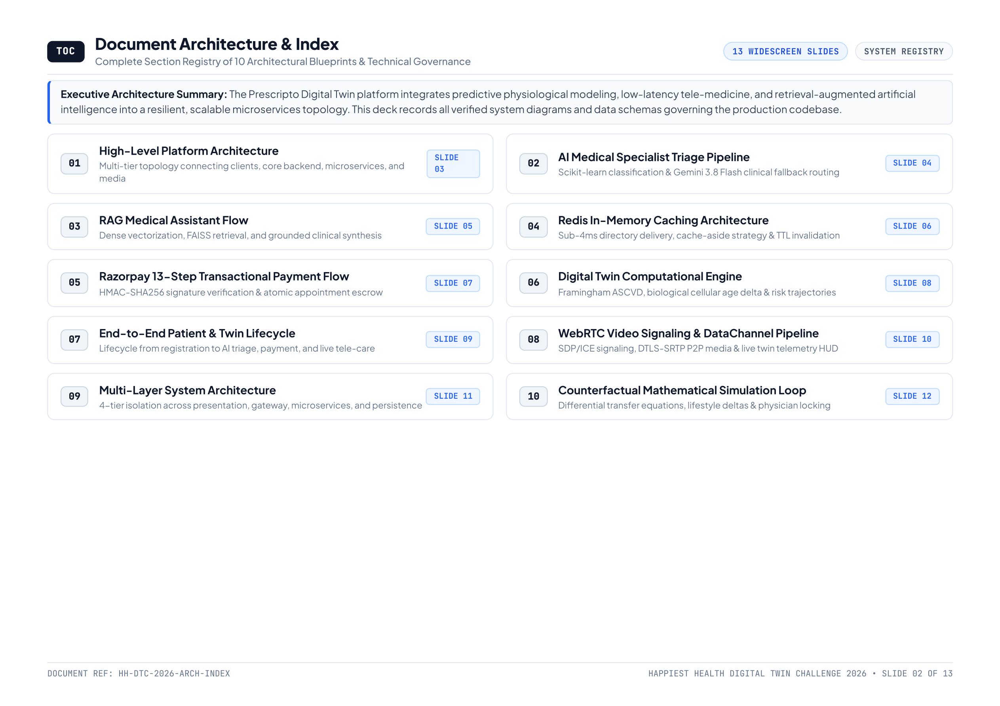

# 🧬 Prescripto Digital Twin — System Architecture & Specification Guide

> **Authoritative Technical Specification & Presentation Guide**  
> *Happiest Health — Digital Twin Challenge 2026*  
> 
> 📥 **[Download Master Architecture Presentation Deck (13 Slides, 16:9 Landscape PDF)](./architecture_diagram.pdf)**

---

## 📑 Complete 13-Slide Architecture Specification Catalog

Below is the verified registry of all 13 slides in the publication-grade Canva/Figma presentation deck, complete with direct links to high-resolution previews:

### Slide 01: Executive Presentation Cover
* **Focus:** Platform identity, metadata, distribution level, and engineering group attribution.
* **Preview:** [slide_01.png](./architecture_deck_slides/slide_01.png)

---

### Slide 02: Document Architecture & Index
* **Focus:** Master table of contents and component registry across 10 core architectural blueprints.
* **Preview:** [slide_02.png](./architecture_deck_slides/slide_02.png)

---

### Slide 03: Diagram 01 — High-Level Multi-Tier Platform Topology
* **Focus:** Enterprise 4-tier separation: Client Presentation (React 19 SPA), API Gateway & Signaling (Express + Socket.IO), Computational Microservices (FastAPI + Scikit-Learn + Gemini 3.8), and Persistence/Cache (MongoDB Atlas + Redis RAM + WebRTC).
* **Preview:** [slide_03.png](./architecture_deck_slides/slide_03.png)

---

### Slide 04: Diagram 02 — AI Medical Specialist Triage Pipeline
* **Focus:** 4-stage natural language symptom triage pipeline: Symptom Ingest & Auth -> ML Inference (Scikit-Learn MultinomialNB trained on 4,920 cases) -> Hybrid Decision Logic (Direct match if $\ge 75\%$, Gemini 3.8 Flash fallback if $< 75\%$) -> Directory & Slot Delivery.
* **Preview:** [slide_04.png](./architecture_deck_slides/slide_04.png)

---

### Slide 05: Diagram 03 — RAG Medical Assistant Flow
* **Focus:** Grounded clinical question-answering eliminating hallucinations: Ingestion & 384-dimensional dense vectorization (`BAAI/bge-small-en-v1.5`) -> Sub-millisecond similarity search over FAISS FlatL2 vector index of peer-reviewed literature -> Grounded synthesis via Gemini 3.8 Flash with safety guardrails.
* **Preview:** [slide_05.png](./architecture_deck_slides/slide_05.png)

---

### Slide 06: Diagram 04 — Redis In-Memory Caching Architecture
* **Focus:** Cache-aside pattern delivering sub-4ms doctor directory queries: Request interception -> Key evaluation (`doctors:all`) -> Dual-path resolution (92% RAM hits vs 8% DB miss write-through) -> Event-driven invalidation hooks on doctor roster updates.
* **Preview:** [slide_06.png](./architecture_deck_slides/slide_06.png)

---

### Slide 07: Diagram 05 — Razorpay 13-Step Transactional Payment Flow
* **Focus:** Cryptographic consultation fee escrow sequence: Order creation -> Checkout execution -> Client signature submission -> Server-side HMAC-SHA256 signature verification -> Order capture status validation -> Atomic MongoDB appointment update and room token release.
* **Preview:** [slide_07.png](./architecture_deck_slides/slide_07.png)

---

### Slide 08: Diagram 06 — Digital Twin Computational Engine Architecture
* **Focus:** Continuous physiological modeling: Ingestion and standardization of 8 clinical biomarkers -> Empirical math core running Framingham Hard ASCVD 10-year risk equation and UKPDS glycemic progression -> Parallel biological age delta and what-if sandbox -> Sub-50ms Socket.IO telemetry synchronization into doctor HUD.
* **Preview:** [slide_08.png](./architecture_deck_slides/slide_08.png)

---

### Slide 09: Diagram 07 — End-to-End Patient & Twin Lifecycle
* **Focus:** 4-stage longitudinal care journey: Registration & Baseline Twin -> Conversational AI Triage & Doctor Matching -> Slot Locking & Razorpay Payment Escrow -> Live Tele-Twin Consultation (WebRTC + Live HUD Calibration) and continuous tracking.
* **Preview:** [slide_09.png](./architecture_deck_slides/slide_09.png)

---

### Slide 10: Diagram 08 — WebRTC Video Signaling & DataChannel Pipeline
* **Focus:** 16-step peer-to-peer connection protocol: Room join & peer discovery via Socket.IO -> SDP offer/answer exchange -> Interactive Connectivity Establishment (ICE candidate pairing) -> Direct DTLS-SRTP encrypted audio/video and sub-30ms DataChannel telemetry synchronization.
* **Preview:** [slide_10.png](./architecture_deck_slides/slide_10.png)

---

### Slide 11: Diagram 09 — Multi-Layer System Architecture & Isolation Boundaries
* **Focus:** Architectural governance enforcing separation of concerns across 4 tiers: Client Presentation UI, API Gateway & Orchestration, Stateless Computational Microservices, and Persistence/Cache with automated circuit breakers.
* **Preview:** [slide_11.png](./architecture_deck_slides/slide_11.png)

---

### Slide 12: Diagram 10 — Counterfactual Mathematical Simulation Loop
* **Focus:** Mathematical formulation of lifestyle intervention deltas: Baseline vitals -> User slider inputs ($\Delta\text{Act}$, $\Delta\text{Nut}$, $\Delta\text{Rx}$) -> Differential transfer equations ($\Delta\text{SBP} = -0.08\Delta\text{Act} - 0.12\Delta\text{Nut} - 0.35\Delta\text{Wgt}$, $\Delta\text{HbA1c} = -0.015\Delta\text{Rx} - 0.01\Delta\text{Nut}$) -> Framingham re-evaluation -> Physician prescription lock.
* **Preview:** [slide_12.png](./architecture_deck_slides/slide_12.png)

---

### Slide 13: Technical Governance & Stack Verification Matrix
* **Focus:** Authoritative runtime manifest mapping all 10 architectural models directly to active files, ports, packages, and cryptographic standards in the Prescripto codebase.
* **Preview:** [slide_13.png](./architecture_deck_slides/slide_13.png)

---

## 💾 PDF Presentation Deck File
* **Filename:** `architecture_diagram.pdf`
* **File Location:** [`docs/architecture_diagram.pdf`](./architecture_diagram.pdf)
* **Format:** 16:9 Widescreen Landscape (297mm × 210mm)
* **Total Pages:** Exactly 13 slides
* **Total File Size:** ~2.5 MB
